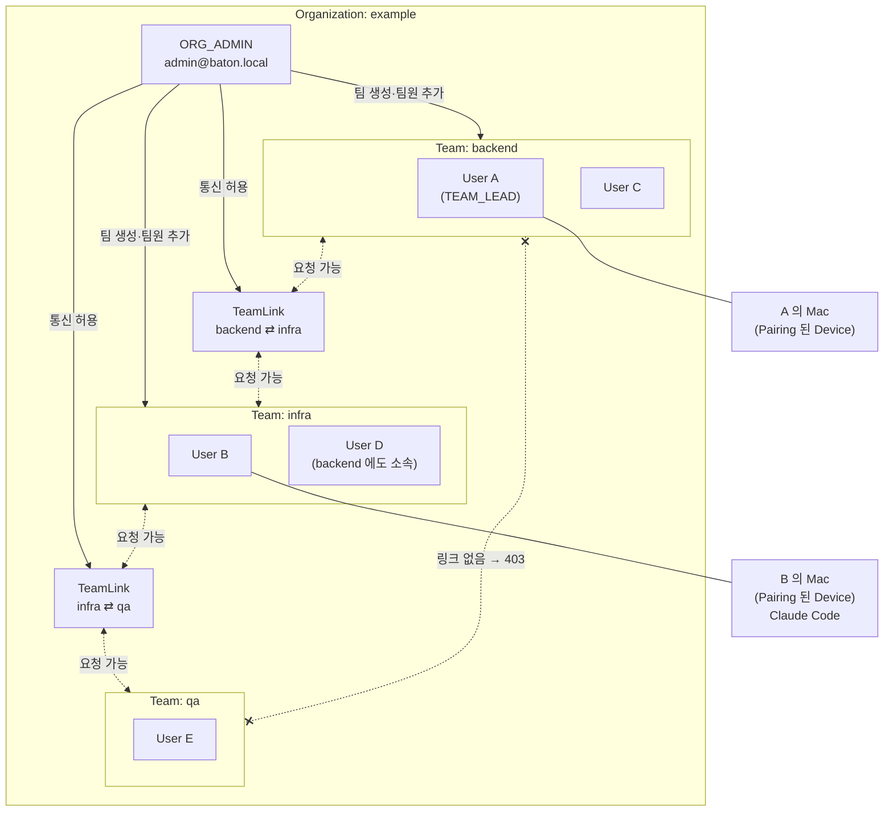
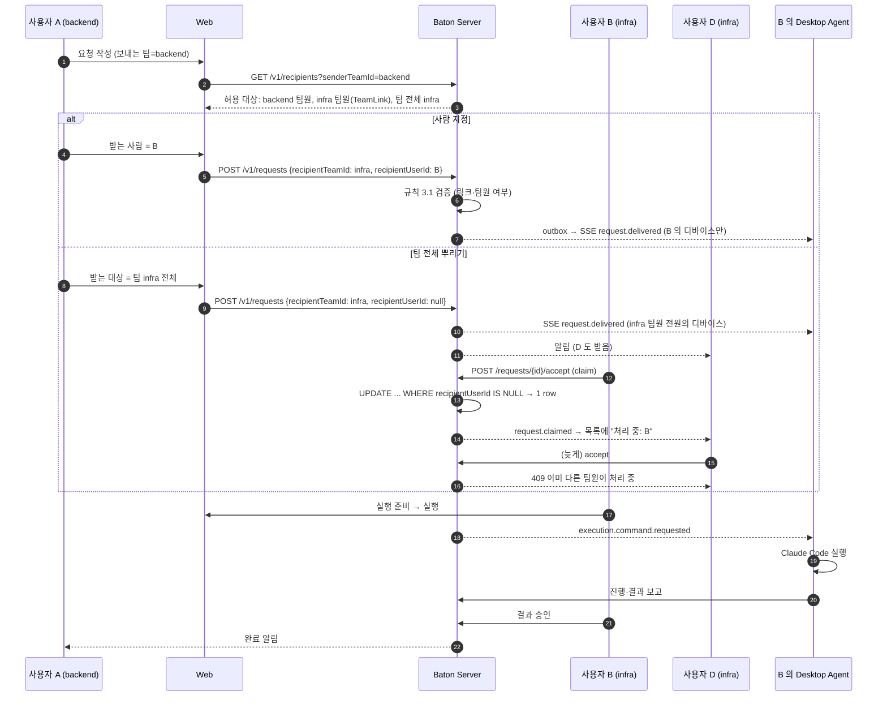
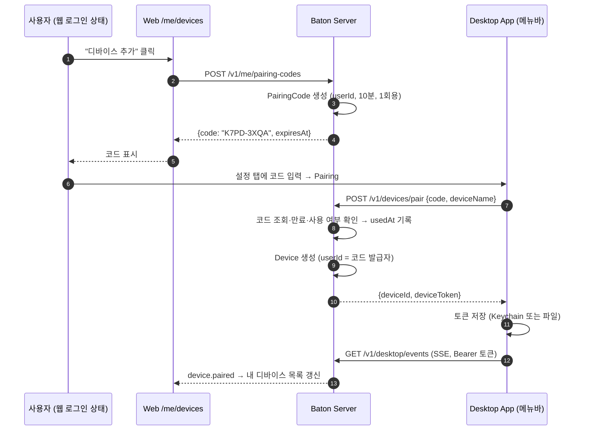
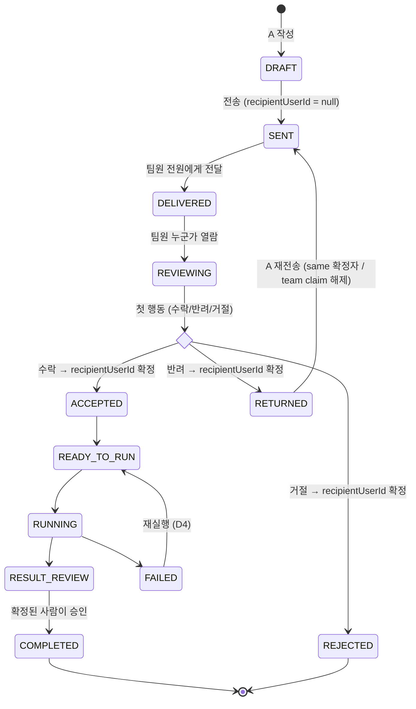

# 05. 조직·팀·통신 허용 모델 (MVP 2차 범위)

작성: 2026-09-07, 코디네이터. 사용자 결정(2026-09-07):

1. 팀 간 통신 허용은 **양방향이 기본**이며 CLO-18부터 방향별 생성·해제를 지원한다.
2. 요청은 **특정 사람에게 직접** 보내거나 **팀 전체에 뿌려서 먼저 받은 사람이 처리**할 수 있다.
3. 한 사람은 **여러 팀**에 속할 수 있다.
4. **조직 내 통신 최우선**. 다른 조직(회사)과의 연결은 별도 단계.

이 문서는 01(도메인·API) 위에 얹는 변경분만 적는다. 01 과 충돌하는 부분은 이 문서가 우선한다.

## 1. 개념

```text
Organization (관리자가 생성)
 ├─ OrgMembership: User ↔ Organization (role: ORG_ADMIN | MEMBER)
 ├─ Team (orgId)
 │    └─ TeamMembership: User ↔ Team (role: TEAM_LEAD | MEMBER)  ← 다대다
 ├─ TeamLink (fromTeamId → toTeamId): 관리자가 허용한 통신 경로 (방향성 행)
 └─ Request (senderTeamId, recipientTeamId, recipientUserId?)
```

### 1.1 구조도



- 실선: 관리자의 관리 행위. 점선: 허용된 통신 경로. `x` 표시: 링크가 없어 서버가 403 으로 막는 경로.
- Pairing(디바이스 ↔ 사용자)은 팀 구조 바깥의 별도 관계다.

- **Pairing 은 디바이스 ↔ 사용자** 등록이다. 조직·팀과 무관하며, 사용자가 웹에서 발급한 본인 전용 코드로만 등록된다.
- **통신 허용은 팀 ↔ 팀** 관계다. 사람은 자기가 속한 팀 중 하나를 "보내는 팀"으로 골라 요청한다.

## 2. 데이터 모델 변경 (Prisma)

| 모델                | 변경                                                                                                                                                                                                                   |
| ------------------- | ---------------------------------------------------------------------------------------------------------------------------------------------------------------------------------------------------------------------- |
| `Organization`      | 신규: `id, name, slug(unique), createdByUserId, createdAt`                                                                                                                                                             |
| `OrgMembership`     | 신규: `orgId, userId, role(ORG_ADMIN\|MEMBER), joinedAt` PK(orgId,userId). MVP 는 사용자당 조직 1개(애플리케이션 규칙으로 강제, 스키마는 다대다 유지)                                                                  |
| `Team`              | `orgId` 추가(필수), `@@unique([orgId, name])`                                                                                                                                                                          |
| `TeamMembership`    | 유지. `role` 은 `TEAM_LEAD\|MEMBER` 로 enum 이름 정리                                                                                                                                                                  |
| `TeamLink`          | 신규: `id, orgId, fromTeamId, toTeamId, createdByUserId, createdAt` `@@unique([fromTeamId, toTeamId])`. 양방향 허용 = 두 행을 한 트랜잭션에 생성. direction에 따라 선택한 한 방향 또는 두 방향을 생성·해제한다(CLO-18) |
| `PairingCode`       | 신규: `id, userId, codeHash, expiresAt, usedAt?, createdAt`. 10분 유효, 1회용                                                                                                                                          |
| `Device`            | 유지 (`userId` 는 PairingCode 로 결정)                                                                                                                                                                                 |
| `Request`           | `teamId` → **`senderTeamId`** 로 의미 변경, **`recipientTeamId`** 추가(필수), **`recipientUserId` nullable** 로 변경(팀 전체 뿌리기 = null), `claimedAt?` 추가                                                         |
| `TimelineEventType` | 추가: `request.claimed`, `team.link_created`, `team.link_revoked`, `team.member_added`, `team.member_removed`, `device.paired`                                                                                         |

전역 `PAIRING_CODE` 환경변수와 `b@baton.local` 하드코딩은 제거한다.

## 3. 규칙

### 3.1 수신자 선택 가능 범위 (서버가 강제, 웹은 같은 규칙으로 목록만 보여 줌)

보내는 사람 U 가 팀 S 로 보낼 때:

- 대상 팀 T 가 S 와 같으면 항상 허용.
- 대상 팀 T ≠ S 이면 `TeamLink(from=S, to=T)` 가 있어야 허용. 링크는 단방향이므로 S→T 허용이 T→S를 허용하지 않는다(CLO-18). POST의 `direction`은 `both`(기본, 두 행), `a-to-b`, `b-to-a`이며 선택 방향만 추가한다.
- 대상 사람 R 을 지정하면 R 은 T 의 멤버여야 한다.
- 다른 조직의 팀·사람은 목록에 나오지 않고 서버도 403.

### 3.2 팀 전체 뿌리기(claim)

- `recipientUserId = null` 로 전송하면 T 의 모든 멤버(발신자 본인 제외)에게 알림이 간다.
- 멤버 누구나 **수락·반려·거절** 중 첫 행동을 하면 그 순간 `recipientUserId` 가 그 사람으로 확정된다(claim). 구현은 조건부 UPDATE (`WHERE recipientUserId IS NULL`) 로 한 번만 성공하고, 늦은 사람은 409 "이미 다른 팀원이 처리 중" 을 받는다.
- claim 시 `request.claimed` Timeline 이벤트와, 나머지 멤버에게 `request.claimed` 알림(목록에서 '처리 중: 홍길동' 으로 표시).
- RETURNED 후 새 revision을 생성하고 `POST /v1/requests/{id}/resend`에 `reassign: "same" | "team"`을 전달한다(CLO-19). 기본 `same`은 확정된 사람에게 재전송한다.
- `team`은 원래 팀 전체 전달 요청(`claimedAt` 존재)에만 허용하며 사람 지정은 400이다. 새 revision 없이 재뿌리기는 409다. `recipientUserId`와 `claimedAt`을 null로 비우고 SENT로 전환하여 현재 팀원 전체(발신자 제외)에 알림·outbox를 다시 발행한다.
- `request.resent`와 `request.rebroadcast` Timeline을 기록한다. 재뿌리기 후 다른 팀원이 기존 규칙으로 claim할 수 있으며 늦은 처리자는 409다.

### 3.3 역할과 권한

| 행위                    | ORG_ADMIN | TEAM_LEAD | MEMBER |
| ----------------------- | --------- | --------- | ------ |
| 조직 설정, 팀 생성·삭제 | O         | –         | –      |
| 팀 간 통신 허용·해제    | O         | –         | –      |
| 팀원 추가·제거          | O         | 자기 팀   | –      |
| 요청 보내기·처리        | O         | O         | O      |
| 디바이스 pairing        | 본인      | 본인      | 본인   |

### 3.4 Pairing 코드

- `POST /v1/me/pairing-codes` → `{ code: "XXXX-XXXX", expiresAt }` (8자, 혼동 문자 제외). 웹 "내 디바이스" 화면에서 발급·표시.
- 데스크톱 앱은 코드 입력 → `POST /v1/devices/pair { code, deviceName }` → 서버가 `PairingCode` 로 사용자를 찾고 `usedAt` 을 찍은 뒤 `Device` 생성.
- 만료·재사용 시 403 + 사유. `device.paired` Timeline(사용자 기준 활동 로그).

### 3.5 요청 흐름 (사람 지정 vs 팀 전체 뿌리기)



### 3.6 Pairing 흐름



### 3.7 팀 뿌리기 요청의 상태



claim 이후의 전이는 01 §3.2 의 1:1 규칙과 동일하다. 늦게 행동한 팀원은 어느 전이에서든 409 를 받는다.

## 4. API 변경 (01 §5 에 추가·수정)

| 메서드·경로                                                                           | 주체                      | 설명                                                                                                                                             |
| ------------------------------------------------------------------------------------- | ------------------------- | ------------------------------------------------------------------------------------------------------------------------------------------------ |
| `GET /v1/me`                                                                          | 웹                        | 조직, 조직 역할, 소속 팀 목록(팀 역할 포함) 추가                                                                                                 |
| `POST /v1/me/pairing-codes`                                                           | 웹                        | 본인 pairing 코드 발급                                                                                                                           |
| `GET /v1/me/devices`, `DELETE /v1/me/devices/{id}`                                    | 웹                        | 내 디바이스 목록·해제                                                                                                                            |
| `POST /v1/devices/pair`                                                               | 데스크톱                  | body `{ code, deviceName }` (전역 코드 제거)                                                                                                     |
| `GET /v1/org`                                                                         | 웹                        | 내 조직                                                                                                                                          |
| `GET/POST /v1/org/teams`, `PATCH/DELETE /v1/org/teams/{id}`                           | ADMIN                     | 팀 관리                                                                                                                                          |
| `POST/DELETE /v1/org/teams/{id}/members`                                              | ADMIN, TEAM_LEAD(자기 팀) | 팀원 추가·제거(기존 사용자 이메일)                                                                                                               |
| `POST /v1/org/users`                                                                  | ADMIN                     | 사용자 생성(이메일·이름·임시 비밀번호) — MVP 초대 대체                                                                                           |
| `GET /v1/org/team-links`, `POST /v1/org/team-links`, `DELETE /v1/org/team-links/{id}` | ADMIN                     | 방향 행 목록·선택 방향 허용·해제. POST `{ teamAId, teamBId, direction? }`, DELETE `{ direction? }` (기본 both, A=:id 행 fromTeamId / B=toTeamId) |
| `GET /v1/recipients?senderTeamId=`                                                    | 웹                        | 3.1 규칙으로 계산한 보낼 수 있는 팀·사람 목록                                                                                                    |
| `POST /v1/requests`                                                                   | 웹                        | body 에 `senderTeamId`, `recipientTeamId`, `recipientUserId?`                                                                                    |
| `POST /v1/requests/{id}/accept\|return\|reject`                                       | 웹                        | 팀 뿌리기 요청이면 claim 을 겸함(3.2)                                                                                                            |
| `GET /v1/requests?box=inbox`                                                          | 웹                        | 본인 지정 요청 + 본인 소속 팀에 뿌려진 미확정 요청                                                                                               |

`GET /v1/org/team-links`는 기존 방향 행 배열이며 각 행에 `teamAId=fromTeamId`, `teamBId=toTeamId`, `direction`(반대 행 존재 시 both, 없으면 a-to-b), `reverseAllowed`를 추가한다. 매트릭스는 from→to 행 존재 여부로 표시한다. 양방향 쌍은 두 행이며 없는 쌍은 양쪽 false다.

Desktop API(01 §5.3)는 변경 없음. 데몬은 pairing 코드 입력만 바뀐다.

## 5. 웹 화면

- **관리자**: `/admin/teams`(팀 목록·생성·팀원), `/admin/team-links`(팀×팀 허용 매트릭스, 발신→수신 단방향 셀 및 양방향 선택), `/admin/users`(사용자 생성).
- **내 설정**: `/me/devices`(pairing 코드 발급 버튼 + 코드 표시 + 디바이스 목록).
- **요청 작성**: "보내는 팀" 선택(소속 팀이 1개면 숨김) → 받는 대상: "사람" 탭(허용 범위 사용자를 팀별로 묶어 표시) / "팀 전체" 탭.
- **받은 요청 목록**: 팀 뿌리기 요청은 배지 "팀: 인프라 · 미확정", claim 되면 "처리 중: 홍길동".

## 6. 데스크톱

- 설정 탭의 pairing code 입력은 유지. 안내 문구를 "웹 → 내 디바이스에서 발급한 코드" 로 변경.
- 알림: 팀 뿌리기 요청은 팀원 모두에게 배너. claim 이후 `request.claimed` 를 받으면 배너 목록에서 제거(알림 탭 표시만 갱신, 데몬 로직 동일).

## 7. Seed / 마이그레이션

- seed: 조직 `example`, 관리자 `admin@baton.local`, 팀 `backend`·`infra`, 사용자 A(backend)·B(infra), TeamLink backend↔infra 양방향. 기존 A/B 시나리오는 그대로 재현된다.
- 기존 데이터는 없다고 보고 `migrate reset` 전제(개발 환경). 운영 데이터 이행은 범위 밖.

## 8. 테스트 추가

- 상태머신: claim 조건부 UPDATE 경합(동시 수락 2건 → 1 성공 1 409).
- 권한: 링크 없는 팀에 전송 403, 링크 해제 후 403, 다른 조직 403, 팀원 아닌 사람 지정 403.
- Pairing: 만료·재사용 403, 발급자와 다른 사용자로 묶이지 않음.
- e2e: A(backend) → 팀 infra 전체 뿌리기 → B claim → 실행 → 승인.

## 9. 후속 및 해결 상태

- 해결 — CLO-18: 단방향 TeamLink API와 방향별 매트릭스 계약.
- 해결 — CLO-19: RETURNED 후 same/team 선택 및 팀 재뿌리기.
- 후속: 조직 간 연결, 이메일 초대 흐름, 팀 수신함의 SLA·재배정.

## 10. 작업 분해

| ID  | 범위                                                                             | 담당           |
| --- | -------------------------------------------------------------------------------- | -------------- |
| W5a | shared 타입·zod + Prisma 스키마·마이그레이션·seed + 조직/팀/링크/pairing API     | codex          |
| W5b | Request 규칙(3.1~3.2)·recipients API·inbox·claim + 테스트(§8)                    | codex (W5a 후) |
| W5c | 웹: 관리자 화면·내 디바이스·요청 작성 대상 선택·목록 배지 (mock 먼저, real 연동) | antigravity    |
| W5d | 데스크톱 안내 문구·claimed 알림 처리 + 통합 검증(§8 e2e, 인수 문서 갱신)         | claude         |

## 11. 확정 사항 (W5d-2 통합 검증, 2026-09-07)

W5a/W5b(서버)·W5c(웹)·W5d-1(데스크톱)을 실제로 붙여 확인한 뒤 확정한 계약이다. 이후 구현은 이 절을 따른다.

### 11.1 서버 → 디바이스 SSE payload

| 이벤트              | payload (outbox, 디바이스용)                                                                                                                                                                                                                                                                                                               |
| ------------------- | ------------------------------------------------------------------------------------------------------------------------------------------------------------------------------------------------------------------------------------------------------------------------------------------------------------------------------------------ |
| `request.delivered` | `{ eventName, requestId, recipientTeam: { id, name }, recipientUserId: string \| null, claimedBy: null, recipientUserIds: string[], title, senderName, revisionNo, webUrl }`. **팀 전체 뿌리기면 `recipientUserId` 가 `null`**, 사람 지정이면 그 사람 id (W5d-2 에서 추가 — 이전에는 없어서 데몬이 사람 지정 요청도 팀 알림으로 표시했다). |
| `request.claimed`   | `{ eventName, requestId, recipientTeam: { id, name }, recipientUserId: <확정된 사람 id>, claimedBy: { id, email, displayName }, recipientUserIds, title, senderName, revisionNo, webUrl }`. 처리한 본인에게는 보내지 않는다.                                                                                                               |

- `claimedBy` 는 서버의 공개 사용자 객체 **`{ id, email, displayName }`** 로 확정한다. 데몬은 `id` 를 기준으로 본인 여부를 판단하고(`userId` 는 구버전 별칭으로만 허용), 표시에는 `displayName` 을 쓴다.
- 데몬은 `recipientTeam` 이 있고 `recipientUserId === null` 일 때만 "팀 <이름> 에 새 요청" 제목을 만든다(04 §10.2).

### 11.2 문서·첨부 접근 규칙 (팀 간 요청)

문서 version(`GET /v1/documents/versions/:id[/download]`)과 첨부(`GET /v1/artifacts/:id`, `POST /v1/uploads`)는 **문서·첨부가 속한 팀(발신 팀)의 멤버** 또는 **그 문서·첨부가 붙은 요청의 접근 권한자**가 읽고 올릴 수 있다. 요청 접근 권한자 = 발신자, 확정된 수신자, 팀 전체 뿌리기 요청(미확정이거나 claim 된)의 수신 팀원. 디바이스 토큰은 소유 사용자의 권한을 그대로 따른다. (W5d-2 에서 발신 팀 멤버십만 보던 것을 고침 — 수신자가 다른 팀이면 데몬이 첨부를 받지 못해 실행이 FAILED 로 끝났다.)

### 11.3 pairing

- 웹 `/me/devices` 에서 발급한 코드(`XXXX-XXXX`, 10분, 1회용)를 메뉴바 앱 설정 탭 또는 `baton login --code` 에 입력한다. 전역 `PAIRING_CODE` 환경변수는 제거됐다.
- 만료·재사용·미발급은 403 + 사유이며 셸 팝오버에 그대로 표시된다. 이미 연결된 데몬이 재-pairing 에 실패해도 기존 연결(`connected`)은 유지된다.

### 11.4 웹

- `?as=<이메일 접두어>`(a, b, admin, c …)로 사용자 전환. 관리자가 만든 계정은 기본 비밀번호 `baton-dev-password` 로 로그인한다.
- 요청 상세의 `executions` 는 생성 순(오래된 것 먼저)으로 내려가며 웹은 마지막 항목을 최신 실행으로 본다.
