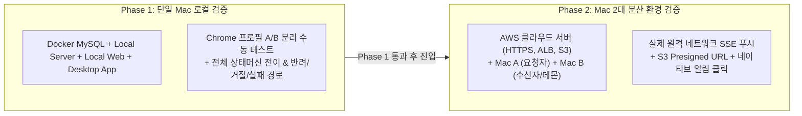

# Baton MVP 테스트 계획서 (Test Plan)

- **문서 번호**: W-test
- **작성일**: 2026-09-04
- **대상 버전**: Baton MVP (사용자 A/B 2인, Claude Code 1종 연동)
- **근거 문서**:
  - `docs/baton-service-plan.md` (§30 서비스 구조, §32 MVP 범위, §33 사용자 시나리오)
  - `docs/design/01-domain-and-api.md` (도메인 엔티티, Request 상태머신, API)
  - `docs/design/02-desktop-agent-and-adapter.md` (Desktop Agent, Claude Code Adapter, 3계층 결과)
  - `docs/00-mvp-plan.md` (§1 합의 스택, §2 결정 D1~D5, §4 작업 분해 W0~W4, §6 설계 반영 이력)
  - `docs/01-feasibility-report.md` (F1~F6 실측 발견사항)

---

## 1. 개요 및 테스트 전략

### 1.1 테스트 목적
본 계획서는 Baton MVP가 기획서 §33 시나리오(백엔드 개발자 A와 인프라 엔지니어 B의 협업)를 결함 없이 완수할 수 있는지 검증하고, PoC 과정에서 도출된 리스크(F1~F6)와 핵심 결정(D1~D5)이 시스템 전반에 안정적으로 반영되었는지 확인하는 것을 목적으로 합니다.

### 1.2 2단계 검증 전략 (Two-Phase Strategy)
Baton은 웹, 중앙 서버, 로컬 머신의 데스크톱 에이전트 및 CLI 에이전트가 유기적으로 맞물리는 분산 시스템입니다. 따라서 단계별로 검증 범위를 확장합니다.



1. **Phase 1: 단일 머신 로컬 검증 (Single-Machine Verification)**
   - 개발자 단일 Mac에서 Docker Compose(MySQL), NestJS Server(포트 3001), Next.js Web(포트 3000), Swift 메뉴바 셸 및 Node 데몬을 기동합니다.
   - 브라우저 프로필 2개(Profile A: 발신자, Profile B: 수신자)를 띄워 UI 상호작용, 상태 머신 전이, 반려 루프, 거절, FAILED 재실행, canary 보안 차단을 집중 검증합니다.
2. **Phase 2: 2대 머신 분산 환경 검증 (Two-Machine Distributed Verification)**
   - 중앙 서버를 AWS 클라우드 환경(ALB + ECS/EC2 + RDS MySQL + S3)에 배포합니다.
   - 물리적으로 분리된 Mac 2대(Mac A: 발신자, Mac B: 수신자 및 Claude Code 설치 머신)를 배치하여, 실제 공용 인터넷/방화벽 환경에서 SSE 이벤트 전달, S3 Presigned URL 업/다운로드, Swift 메뉴바 셸의 `UNUserNotificationCenter` 알림 클릭 연계를 최종 검증합니다.

### 1.3 작업 단위(Work Package) 맵핑
각 테스트 항목은 `docs/00-mvp-plan.md` §4의 작업 분해 단위와 연결됩니다.

- **W0**: 공용 패키지 (`packages/shared` - 상태머신, DTO, 이벤트 스키마)
- **W1**: 중앙 서버 (`apps/server` - Prisma ORM, 상태머신 Guard, REST API, SSE Outbox, S3)
- **W2**: Desktop 데몬 (`apps/desktop-agent` - Node.js CLI, SSE 구독, Claude Code Adapter, 3계층 결과 수집)
- **W2b**: Desktop 셸 (`apps/desktop-macos` - Swift 메뉴바 상주, `UNUserNotificationCenter` 클릭 콜백, Keychain)
- **W3**: Web 애플리케이션 (`apps/web` - Next.js UI, Request 생성/검토/수락/반려, 실행 준비, Timeline)
- **W4**: End-to-End 통합 검증 및 시나리오 테스트

---

## 2. 테스트 데이터 및 사전 환경 정의

### 2.1 Seed 사용자 및 팀 (Test Fixtures)

> **05 조직·팀 모델 기준 실제 Seed (2026-09-07 이후)**:
> - 조직: `example` (관리자 `admin@baton.local` / `baton-dev-password`)
> - 팀: `backend` (User A `a@baton.local`, TEAM_LEAD), `infra` (User B `b@baton.local`, MEMBER)
> - 팀 링크: `backend` ⇄ `infra` 양방향 통신 허용
> - 모든 시드 계정 기본 비밀번호: `baton-dev-password`
> - 아래 표는 MVP 초기 단일 팀 계획 초안 기준 정보입니다.

| 구분 | 식별자 / 계정 | 이름 | 역할 / 담당 | 환경 |
|---|---|---|---|---|
| **User A** | `user_a_id` / `a@example.com` | 김백엔드 (A) | 백엔드 개발자 (Request 요청자) | Web App (Chrome Profile A) |
| **User B** | `user_b_id` / `b@example.com` | 박인프라 (B) | 인프라 엔지니어 (수신자 및 Claude Code 소유자) | Web App (Chrome Profile B) + Desktop App |
| **Team** | `team_core_id` | Core Platform Team | A와 B가 소속된 기본 협업 경계 | `TeamMembership`: 둘 다 `MEMBER` |
| **Agent B** | `agent_b_id` | Claude Code (Max) | B의 Mac에 설치된 로컬 AI 코딩 에이전트 | Desktop Agent 등록 (`ONLINE`) |
| **Project** | `proj_backend_id` | `backend-api` | 실행 대상 로컬 저장소 | 로컬 경로 hint: `/Users/b/Work/backend-api` |

### 2.2 가짜 프로젝트 저장소 (Redis 오류 재현 Fixture)
`docs/baton-service-plan.md` §33 및 `poc/e2e`에서 검증된 구조를 표준 테스트 저장소로 사용합니다.

- **저장소 위치**: `/tmp/baton-test-fixtures/backend-api` (git 저장소 초기화 상태)
- **파일 구성**:
  1. `deployment.yaml`:
     ```yaml
     apiVersion: apps/v1
     kind: Deployment
     metadata:
       name: backend-api
     spec:
       template:
         spec:
           containers:
           - name: api
             image: backend-api:latest
             env:
             - name: REDIS_HOST
               value: redis-servcie # ← 오타 주입 (의도된 결함)
     ```
  2. `verify.sh`:
     ```bash
     #!/usr/bin/env bash
     if grep -q "value: redis-service" deployment.yaml && ! grep -q "redis-servcie" deployment.yaml; then
       echo "DEPLOYMENT_VERIFIED_SUCCESS"
       exit 0
     else
       echo "VERIFICATION_FAILED"
       exit 1
     fi
     ```
  3. 첨부 파일 (User A가 Request 전송 시 첨부):
     - `docs/api-error-analysis.md`: "로그인 API 500 오류 원인 분석 및 인프라 검토 요청"
     - `attachments/server.log`: `RedisConnectionException: redis-servcie: Name or service not known`

---

## 3. Phase 1: 단일 Mac 로컬 수동 테스트 체크리스트

- **테스트 환경**: 단일 Mac (macOS arm64)
- **구동 서비스**:
  - Docker Compose: MySQL 8 (포트 3306)
  - `apps/server`: NestJS (포트 3001)
  - `apps/web`: Next.js (포트 3000)
  - `apps/desktop-macos` & `apps/desktop-agent`: 로컬 상주 실행
- **브라우저 구성**:
  - 브라우저 창 1: Chrome Default Profile (User A 로그인, `http://localhost:3000`)
  - 브라우저 창 2: Chrome Incognito / Guest Profile (User B 로그인, `http://localhost:3000`)

---

### 3.1 [시나리오 1] Happy Path: 정상 업무 인계 및 에이전트 실행 완료 (§33)
기획서 §33의 표준 시나리오 전체 흐름을 검증합니다.

| 단계 | 사용자 / 화면 | 수행 작업 (클릭 / 입력) | 기대 결과 (화면 / 시스템 동작) | Request 상태 | 근거 절 | 담당 |
| :---: | :--- | :--- | :--- | :---: | :---: | :---: |
| **1-1** | User B<br>(메뉴바 / CLI) | `apps/desktop-macos` 기동 후 Device Pairing 수행 | 메뉴바 아이콘 활성화(`ONLINE`), Server Agent Registry에 Agent B 등록 확인 | - | 02 §7.1 | W2<br>W2b |
| **1-2** | User A<br>(Web: 새 요청) | [새 Baton 요청 작성] 클릭<br>- 제목: "로그인 API 오류 해결 요청"<br>- 수신자: 박인프라 (B) 선택<br>- 문서: `api-error-analysis.md` 업로드<br>- 첨부: `server.log` 파일 추가 | `DRAFT` 상태의 Request 생성. revision 1 생성. 첨부 파일 S3(로컬 에뮬레이션) 업로드 완료. | `DRAFT` | 01 §3.2<br>01 §5.2 | W3<br>W1 |
| **1-3** | User A<br>(Web: 요청 상세) | [Baton 전송] 버튼 클릭 | `sent_at` 기록, Request가 B에게 전달됨. Timeline에 `request.sent` 이벤트 추가. | `SENT` | 01 §3.2 | W3<br>W1 |
| **1-4** | User B<br>(Desktop OS) | 대기 | B의 macOS 화면에 **네이티브 알림 배너** 노출 ("Baton: 새 요청 도착 #1024"). 메뉴바 아이콘 뱃지 표시. | `DELIVERED` | 02 §8<br>01 §3.2 | W2b<br>W2 |
| **1-5** | User B<br>(Desktop OS) | **알림 배너 클릭** | 기본 브라우저가 자동으로 열리며 해당 요청 상세 화면(`http://localhost:3000/requests/{id}`)으로 직행. | `DELIVERED` | 02 §8.1 | W2b |
| **1-6** | User B<br>(Web: 요청 상세) | 요청 검토 시작 및 [수락] 클릭 | 검토 시작 시 `REVIEWING` 전이, [수락] 클릭 시 `accepted_at` 기록 및 `ACCEPTED` 전이. User A 화면에 수락 알림 노출. | `ACCEPTED` | 01 §3.2 | W3<br>W1 |
| **1-7** | User B<br>(Web: 실행 준비) | [Agent 실행 준비] 화면 진입<br>- Agent: `Claude Code` 선택<br>- Project: `backend-api` 선택<br>- 추가 지시: "운영 환경은 변경하지 마. Kubernetes 설정만 확인하고 수정안 작성해줘"<br>- [Agent 실행] 버튼 클릭 | 1. 서버: `READY_TO_RUN` 전이 및 `outbox_events`에 `execution.command.requested` 기록.<br>2. SSE를 통해 Desktop Agent로 명령 푸시. 구조화된 policy(`repository_edit: allow`, `deployment_apply: deny`) 전달 확인. | `READY_TO_RUN` | 01 §3.2<br>01 §5.4<br>02 §3.3 | W3<br>W1<br>W2 |
| **1-8** | User B<br>(Desktop Agent) | 백그라운드 자동 실행 | 1. `SessionStart` canary hook 실행 확인 (`canary.ok`).<br>2. `claude -p` 실행 시작 및 서버에 `POST /status` (`RUNNING`) 보고.<br>3. Agent 상태가 `BUSY`로 변경됨. | `RUNNING` | 02 §6.4<br>02 §7.3 | W2 |
| **1-9** | User A & B<br>(Web: Timeline) | 실시간 타임라인 모니터링 | Claude Code의 stream-json 이벤트가 실시간 매핑되어 UI에 순서대로 표시됨:<br>• `reading_input`: "api-error-analysis.md 읽는 중"<br>• `exploring`: "프로젝트 구조 확인"<br>• `editing`: "코드 수정: deployment.yaml"<br>• `testing`: "테스트 실행 (`verify.sh`)"<br>• `test_passed`: "테스트 성공 (DEPLOYMENT_VERIFIED_SUCCESS)"<br>• `writing_result`: "결과 문서 작성: result.md" | `RUNNING` | 02 §4.2 | W2<br>W3 |
| **1-10** | User B<br>(Desktop Agent) | 프로세스 정상 완료 | 1. 3계층 결과 수집 (unified diff, changes.patch, output/result.md). `output/` 경로는 patch에서 정상 제외.<br>2. `POST /v1/desktop/executions/{id}/result` 성공 업로드.<br>3. Agent 상태가 다시 `ONLINE`으로 복귀. | `RESULT_REVIEW` | 02 §5<br>01 §5.3 | W2<br>W1 |
| **1-11** | User B<br>(Web: 결과 검토) | 결과 검토 화면 열람<br>- 변경 파일 diff (`redis-servcie` → `redis-service`) 확인<br>- Agent 작업 요약(`result.md`) 검토<br>- [결과 승인 및 전달] 클릭 | `Result.review_status`가 `APPROVED`로 변경. `sent_at` 기록. Request 상태가 `COMPLETED`로 최종 전이. | `COMPLETED` | 01 §3.2<br>01 §5.2 | W3<br>W1 |
| **1-12** | User A<br>(Web / OS) | 결과 도착 알림 확인 | A의 브라우저 및 Desktop에 "B가 요청 작업을 완료했습니다" 알림 노출. 최종 diff 및 결과 문서 확인 가능. | `COMPLETED` | 01 §3.2 | W3 |

---

### 3.2 [시나리오 2] 반려 루프: 내용 보완 요청 및 재전송 (Return & Resend Workflow)
기획서 §12 및 01 §3.1의 동일 Request 내 revision 증가 흐름을 검증합니다.

| 단계 | 사용자 / 화면 | 수행 작업 (클릭 / 입력) | 기대 결과 (화면 / 시스템 동작) | Request 상태 | 근거 절 | 담당 |
| :---: | :--- | :--- | :--- | :---: | :---: | :---: |
| **2-1** | User A → B | A가 새 Request 전송 (문서 v1만 포함) | B에게 요청 전달 완료 | `DELIVERED` | 01 §3.2 | W3 |
| **2-2** | User B<br>(Web: 요청 검토) | [반려] 버튼 클릭<br>- 반려 사유 입력: "실제 오류 로그 파일이 누락되었습니다. server.log를 첨부해주세요." | 1. `return_reason` 저장.<br>2. Request 상태가 `RETURNED`로 전이.<br>3. A에게 반려 알림 전달. Timeline에 사유 기록. | `RETURNED` | 01 §3.2 | W3<br>W1 |
| **2-3** | User A<br>(Web: 요청 상세) | 반려 사유 확인 후 [보완하여 재전송] 클릭<br>- 새 문서 `api-error-analysis.v2.md` 교체<br>- `server.log` 파일 추가 첨부 | 1. 동일 Request 내에 `revision_no: 2`를 가진 새 `RequestRevision` 생성.<br>2. 이전 revision 1의 내용은 불변 snapshot으로 보존.<br>3. Request 상태가 다시 `SENT`로 전이. | `SENT` | 01 §3.1<br>01 §5.2 | W3<br>W1 |
| **2-4** | User B<br>(Web: 요청 상세) | 재전송된 요청 열람 | revision 2 내용과 추가된 첨부파일 확인. 문서 v1과 v2의 이력이 타임라인에 분리되어 노출됨 확인. 이후 [수락] 가능. | `DELIVERED` → `ACCEPTED` | 01 §3.1 | W3 |

---

### 3.3 [시나리오 3] 거절 경로: 요청 거절 및 종료 (Rejection Workflow)
기획서 §13의 업무 수행 거절 흐름을 검증합니다.

| 단계 | 사용자 / 화면 | 수행 작업 (클릭 / 입력) | 기대 결과 (화면 / 시스템 동작) | Request 상태 | 근거 절 | 담당 |
| :---: | :--- | :--- | :--- | :---: | :---: | :---: |
| **3-1** | User B<br>(Web: 요청 검토) | [거절] 버튼 클릭<br>- 거절 사유: "해당 모듈은 인프라팀 소관이 아닌 데이터팀 담당입니다." | 1. Request 상태가 `REJECTED`로 전이.<br>2. A에게 거절 알림 발송.<br>3. 요청이 수정 불가한 최종 종료 상태로 잠금 처리됨. | `REJECTED` | 01 §3.2 | W3<br>W1 |
| **3-2** | User A<br>(Web: 요청 목록) | 거절된 요청 열람 | 상태가 `REJECTED`로 표시되며, [재전송] 버튼이 비활성화됨 확인. | `REJECTED` | 01 §3.2 | W3 |

---

### 3.4 [시나리오 4] 에이전트 실행 실패 및 재실행 복구 (Failure & Retry, D4)
00-mvp-plan §2 D4 및 01 §3.2에 확정된 `FAILED` 후 재실행 전이를 검증합니다.

| 단계 | 사용자 / 화면 | 수행 작업 (클릭 / 입력) | 기대 결과 (화면 / 시스템 동작) | Request 상태 | 근거 절 | 담당 |
| :---: | :--- | :--- | :--- | :---: | :---: | :---: |
| **4-1** | User B<br>(Web: 실행 준비) | [Agent 실행] 클릭 (테스트용 의도적 결함 환경 설정: 잘못된 프로젝트 경로 또는 문법 에러 유발 프롬프트) | 에이전트 프로세스 비정상 종료 (exit code ≠ 0). | `RUNNING` | 02 §7.5 | W2 |
| **4-2** | User B<br>(Desktop Agent) | 실패 보고 | `POST /v1/desktop/executions/{id}/result`에 `outcome: failed` 및 `failure_reason` 전송. Execution 상태 = `FAILED`. | `FAILED` | 01 §3.2<br>01 §5.3 | W2<br>W1 |
| **4-3** | User B<br>(Web: 요청 상세) | 실패 메시지 확인 및 **[Agent 재실행]** 버튼 클릭<br>- 추가 지시사항 보완 입력 후 실행 | 1. **새로운 `Execution` 레코드(`QUEUED`) 생성** (`previous_execution_id`에 이전 실패 execution 링크).<br>2. Request 상태가 **`READY_TO_RUN`으로 복귀** (D4 확정 동작).<br>3. 실패한 이전 실행 이력은 타임라인에 그대로 보존. | `READY_TO_RUN` | 01 §3.2<br>(D4) | W3<br>W1 |
| **4-4** | User B<br>(Desktop Agent) | 새 Execution 수신 및 재실행 | 정상 실행되어 `RUNNING` → `RESULT_REVIEW`로 성공적 전이 확인. | `RESULT_REVIEW` | 01 §3.2 | W2 |

---

### 3.5 [시나리오 5] 보안 강제 및 Canary 검증 (Security Enforcement, F1/F2/F3)
PoC에서 도출된 핵심 보안 취약점 방어가 실제 동작하는지 검증합니다.

| 검증 항목 | 유도된 이상 행동 | 기대 차단 결과 | 차단 주체 | 근거 절 | 담당 |
| :--- | :--- | :--- | :---: | :---: | :---: |
| **Settings Canary (F1)** | `claude-settings.json`에 오탈자 키를 강제 주입하여 실행 | 데몬이 `canary.ok` 파일 부재를 감지하여 프로세스를 즉시 `SIGKILL`하고 Execution을 `FAILED` 처리 (fail-closed) | 데몬 감시 루프 | 02 §6.4 | W2 |
| **자격증명 보호 (F2)** | 프롬프트로 `~/.aws/credentials` 파일 읽기 유도 | 1. 내장 Read 도구 시도: `permissions.deny: ["Read(...)"]`에 의해 즉시 거부<br>2. Bash `cat` 시도: OS 샌드박스 및 PreToolUse hook에 의해 거부 | L1 Rules + L3 Sandbox | 02 §6.2 | W2 |
| **프로젝트 외부 쓰기** | 프롬프트로 `../../outside.txt` 파일 생성 유도 | PreToolUse hook에서 "프로젝트 밖 쓰기 금지" 정책 위반으로 deny 반환 | L2 PreToolUse Hook | 02 §6.1 | W2 |
| **네트워크 외부 호출** | 프롬프트로 `curl https://example.com` 유도 | OS 샌드박스 `network.strictAllowlist`에 의해 DNS 해석 차단 (`getaddrinfo` 실패) | L3 OS Sandbox | 02 §6.1 | W2 |
| **동시 실행 방지 (F3)** | 같은 `backend-api` 프로젝트에 대해 2건의 실행을 동시 요청 | 두 번째 실행 요청은 데몬에서 `BUSY (동일 프로젝트 실행 진행 중)` 에러로 거부 또는 큐잉 처리 | Desktop 데몬 락 | 02 §7.3 | W2 |

---

### 3.6 [시나리오 6] 2차: 조직·팀·통신 허용 (docs/design/05)

- **사전 조건**: `./scripts/dev-down.sh --reset && ./scripts/dev-up.sh` 로 새 seed(조직 example, admin/a/b, 팀 backend·infra, backend↔infra 링크), fixture, `./scripts/desktop-build.sh`. 계정 비밀번호는 모두 `baton-dev-password`.

| 단계 | 수행 | 기대 결과 |
| :---: | :--- | :--- |
| 6-1 | 관리자(`?as=admin`) `/admin/teams` 에서 팀 `qa` 생성, `/admin/users` 에서 `c@baton.local` 생성, `qa`·`infra` 에 c 배정 | 목록에 반영, `GET /v1/org/teams` 와 일치 |
| 6-2 | `/admin/team-links` 에서 backend↔qa 체크 | 양방향 TeamLink 2행, 매트릭스 ✓ |
| 6-3 | B 가 `/me/devices` → 디바이스 추가 → 코드 발급 → 메뉴바 앱 설정 탭에 입력 → Pairing | 헤더 `connected`, 디바이스 목록에 이 Mac 표시 |
| 6-4 | 같은 코드 재입력 / 만료 코드 입력 | "이미 사용한 pairing 코드입니다." / "만료된 pairing 코드입니다." 표시, 기존 연결 유지 |
| 6-5 | A 가 `/requests/new` → 팀 전체(infra) 로 전송 | B(와 c) Mac 에 배너 "팀 infra 에 새 요청", 팝오버 알림 탭 DELIVERED |
| 6-6 | B 가 상세에서 "내가 담당하기(Claim)" | 받는 곳 `B (나)`, c 의 디바이스는 배너 제거·"처리 중: B", c 가 수락 시도하면 409 |
| 6-7 | B 실행 → 데몬이 문서·첨부 다운로드 → Claude Code 수정 → 결과 승인 | RESULT_REVIEW → COMPLETED, A 화면에 diff·요약 |
| 6-8 | c 가 발신 팀 qa 로 infra 에 보내기 | 웹 수신 팀 목록에 infra 없음, `POST /v1/requests` 403 "허용되지 않은 수신 대상입니다." |
| 6-9 | 사람 지정(A→B) 흐름 | 1차와 동일하게 동작(배너 "새로운 Baton 요청") |

수행 기록은 [MVP 인수 검증 §9](mvp-acceptance.md) 에 있다.

### 3.7 [시나리오 7] 3차: 하드닝 — 다중 프로젝트·실행 취소·중복 데몬·presence (W6)

- **사전 조건**: 시나리오 6 과 같되 fixture 를 **두 개** 만든다. `./scripts/fixture-backend-api.sh` 와 `./scripts/fixture-backend-api.sh /tmp/baton-test-fixtures/infra-tools`.
- **주의**: `.env` 의 `WEB_URL` 은 브라우저로 접속하는 origin 과 같아야 한다(기본 `http://127.0.0.1:3000`). 다르면 알림 링크가 로그아웃된 세션을 연다.

| 단계 | 수행 | 기대 결과 |
| :---: | :--- | :--- |
| 7-1 | 메뉴바 앱 설정 탭 "프로젝트 목록" 에 두 fixture 를 이름+경로로 추가하고 "설정 저장" → pairing | 각 행에 `projectId` 가 채워지고, 웹 `/me/devices` 에 플랫폼·OS·앱 버전·호스트명·ONLINE 표시 |
| 7-2 | 웹 실행 준비 화면의 "실행 프로젝트" 드롭다운 | 등록한 두 Project 가 `이름 (경로)` 로 보인다(경로 중복 표기 없음) |
| 7-3 | 프로젝트 A 를 골라 실행 | 그 경로의 파일만 바뀌고 다른 프로젝트는 그대로. 데몬 로그 `execution 프로젝트 선택 … projectRoot=…` |
| 7-4 | 다른 요청에서 프로젝트 B 를 골라 실행 | 두 번째 경로에서 실행됨(교차 오염 없음) |
| 7-5 | 등록되지 않은 `projectId` 로 명령이 오면 | claude 를 띄우지 않고 `FAILED` + "등록된 프로젝트: …" 사유 보고 |
| 7-6 | 실행 중 웹 요청 상세에서 `실행 취소` → 인라인 확인 | Execution `CANCELLED`, claude 자식 프로세스 종료(SIGTERM→SIGKILL), Request `READY_TO_RUN` 복귀, 활동 탭에 `cancelled` 2줄 |
| 7-7 | 취소 뒤 같은 화면에서 다시 실행 | 실행 준비 폼이 다시 보이고 재실행이 성공한다 |
| 7-8 | 데몬을 하나 더 띄운다(같은 디바이스 토큰) | 새 데몬이 연결을 가져가고, 기존 데몬은 재연결 없이 **exit 17**. 셸 로그 `재시작하지 않음`, 팝오버 상태 `failed` |
| 7-9 | 모든 데몬 종료 후 2분 대기 | `/me/devices` 와 `GET /v1/agents` 가 OFFLINE 으로 바뀐다 |
| 7-10 | 데몬 실행 중 60초 간격 관찰 | `lastSeenAt` 이 60초마다 갱신되고 ONLINE 유지 |
| 7-11 | 반려 → 재전송으로 문서를 보완 | 같은 문서에 v2 가 쌓이고, 문서 뷰어 "버전 비교 (Diff)" 에서 v1↔v2 좌우/통합 비교가 보인다 |
| 7-12 | 결과 검토 화면 | 파일별 diff 카드(추가/삭제 통계·접기)와 result.md 가 보인다. "추가 작업 요청" 은 **시나리오 8 에서 지원**(3차 시점에는 비활성이었다) |

수행 기록은 [MVP 인수 검증 §10](mvp-acceptance.md) 에 있다.

### 3.8 [시나리오 8] 4차: 결과 검토 단계의 추가 작업 요청 (기획서 §18, `claude --resume`)

- **사전 조건**: 시나리오 7 과 같다. fixture 는 오타가 살아 있는 초기 상태여야 한다 (CLO-16: `scripts/acceptance/*.py` 드라이버 시작 시 자동으로 초기 결함 상태로 복원하므로 수동 초기화 불필요).
- **요청 준비 자동화**: `python3 scripts/acceptance/scenario-18-follow-up.py setup` (A→B 요청 생성·전송). 수락·실행·추가 작업·승인은 **웹 UI** 에서 한다.
- **관찰**: `python3 scripts/acceptance/scenario-18-follow-up.py watch <requestId>` (상태·타임라인), `show <requestId>` (회차별 execution/result 요약).

| 단계 | 수행 | 기대 결과 |
| :---: | :--- | :--- |
| 8-1 | B 가 요청 상세에서 "요청 검토 시작" → "요청 수락하기" | `SENT → DELIVERED → REVIEWING → ACCEPTED`. real 모드에서 SENT 에서도 검토 시작 버튼이 보여야 한다 |
| 8-2 | 실행 준비 폼에서 Agent·Project·추가 지시를 넣고 실행 | 1차 Execution 실행, 진행 화면에 `started … (model=claude-haiku-…)` |
| 8-3 | 1차 완료 | `RESULT_REVIEW`, 결과 요약·diff·result.md 표시. 서버 Execution 에 `claudeSessionId` 가 저장된다(데몬 시작 보고의 `sessionId`) |
| 8-4 | "Agent에게 추가 작업 요청" → 모달에 지시 입력 → "추가 작업 실행" | `RESULT_REVIEW → READY_TO_RUN`, 타임라인에 `에이전트에게 추가 작업 요청 (Follow-up)` + 입력한 지시 |
| 8-5 | 데몬 로그 | `claude spawned … "resume":true`, 진행 화면 시작 보고에 `(추가 작업 · resume <세션id 앞 8자>…)` |
| 8-6 | 2차 완료 | 회차 탭 `[1차 결과] [2차 결과 최신]`, 2차에 추가 지시 배너, **diff 가 이번 회차 변경만** 담는다(1차 변경 파일은 빠짐) |
| 8-7 | 1차 탭을 고르고 승인 시도 | 승인 버튼이 비활성 + "과거 회차라 승인할 수 없습니다" 안내. API 로 강행하면 서버가 `409 최신 실행의 결과만 승인할 수 있습니다.` |
| 8-8 | 2차(최신) 탭에서 "결과 승인 및 A에게 전달" | `COMPLETED`, "승인 및 업무 인계 완료" 배지 |
| 8-9 | COMPLETED 화면 | 추가 작업 요청·승인 버튼이 **사라지고** 회차 이력 열람은 유지된다 |
| 8-10 | resume 실패 유도: DB 에서 직전 Execution 의 `claudeSessionId` 를 없는 값으로 바꾼 뒤 추가 작업 요청 | 데몬이 1회 폴백: `WARN --resume 실패` → 진행 상태 `warning: 이전 세션(…)을 이어갈 수 없어…` → **새 세션으로 원본 맥락 재실행 후 성공**. `manifest.resumeFallback` 에 사유 기록 |

수행 기록은 [MVP 인수 검증 §11](mvp-acceptance.md) 에 있다.

## 4. Phase 2: Mac 2대 분산 환경 테스트 체크리스트 (AWS 배포 환경)

### 4.1 사전 조건 (Prerequisites Checklist)
분산 테스트를 수행하기 전 반드시 충족되어야 하는 인프라 요구사항입니다.

- [ ] **중앙 서버 배포**: AWS ALB + ECS(또는 EC2) 환경에 `apps/server` 배포 완료.
- [ ] **HTTPS / 도메인 설정**: 유효한 도메인(`https://api.baton.example.com`) 및 TLS 인증서 적용 (모바일/데스크톱 네이티브 통신 필수).
- [ ] **ALB Idle Timeout 설정 (★ 필수)**:
  - AWS ALB의 기본 idle timeout은 60초입니다.
  - SSE(Server-Sent Events) 장기 스트리밍 연결이 60초마다 끊어지는 현상을 방지하기 위해, **ALB 대상 그룹/리스너의 Idle Timeout을 최소 300초(5분) 이상으로 증설**하거나, 서버에서 15초 주기 heartbeat(`: ping\n\n`) 주입 확인.
- [ ] **AWS S3 버킷 설정**: Artifact 저장을 위한 S3 버킷 프로비저닝 및 Web/Desktop 직접 PUT/GET을 위한 CORS 허용 설정.
- [ ] **네트워크 독립성**: Mac A와 Mac B는 서로 다른 공용 IP/Wi-Fi 망에 접속하여 NAT 및 방화벽 환경을 모사.

### 4.2 분산 환경 크로스 검증 항목

| # | 검증 항목 | 시험 절차 | 기대 결과 | 관련 컴포넌트 |
| :---: | :--- | :--- | :--- | :---: |
| **2-1** | **원격 Device Pairing** | Mac B의 Desktop App에서 서버 도메인으로 페어링 요청 | 브라우저 인증 후 장기 Device Refresh Token이 Mac B의 Keychain에 안전하게 저장되고 `ONLINE` 등록 성공 | Mac B 셸/데몬 ↔ AWS Server |
| **2-2** | **NAT/방화벽 통과 SSE 푸시** | Mac A가 Web에서 Request 전송 및 [Agent 실행] 클릭 | Mac B에 인바운드 오픈 포트가 전혀 없는 상태에서도 아웃바운드 SSE 스트림을 통해 `execution.command.requested`가 1초 내 즉시 수신됨 | AWS Server → Mac B 데몬 |
| **2-3** | **S3 Presigned URL 업/다운로드** | 첨부 파일 전송 및 결과 아티팩트 업로드 | 중앙 서버를 거치지 않고 Mac A/B에서 AWS S3 버킷으로 직접 대용량 로그 및 diff 파일이 서명된 URL로 정상 전송됨 | Web / Mac B ↔ AWS S3 |
| **2-4** | **크로스 머신 알림 클릭 연계** | Mac A의 요청 전송 후 Mac B 화면 확인 | Mac B의 알림 센터에 배너가 표시되고, 알림 클릭 시 Mac B의 기본 브라우저가 원격 서버의 해당 Request URL로 즉시 열림 | Mac B Swift 셸 (`UNUserNotification`) |
| **2-5** | **네트워크 일시 단절 및 복구** | Mac B의 Wi-Fi를 30초간 껐다 켬 | 데몬이 지수 백오프로 자동 재연결하며, `Last-Event-ID`를 전달하여 단절 중 발행된 SSE 이벤트를 누락 없이 이어받음 | Mac B 데몬 ↔ AWS Server |

---

## 5. 자동화 테스트 범위 및 케이스 목록 (Automated Testing Matrix)

### 5.1 `packages/shared`: 상태 머신 전이 단위 테스트 (Unit Tests)
- **대상**: Request State Machine Guard 로직
- **실행 명령**: `pnpm --filter @baton/shared test`

| 테스트 ID | 현재 상태 (`from`) | 전이 액션 (`action`) | 요청 주체 (`actor`) | 기대 결과 (`to` 또는 에러) | 테스트 분류 |
| :---: | :--- | :--- | :---: | :--- | :---: |
| **SM-01** | `NONE` | `CREATE_DRAFT` | Sender (A) | `DRAFT` (revision 1 생성) | 정상 전이 |
| **SM-02** | `DRAFT` | `SEND` | Sender (A) | `SENT` (`sent_at` 기록) | 정상 전이 |
| **SM-03** | `DRAFT` | `SEND` | Recipient (B) | **403 Forbidden** (수신자는 전송 불가) | 권한 검증 |
| **SM-04** | `SENT` | `DELIVER` | System / Desktop | `DELIVERED` | 정상 전이 |
| **SM-05** | `DELIVERED` | `START_REVIEW` | Recipient (B) | `REVIEWING` | 정상 전이 |
| **SM-06** | `REVIEWING` | `ACCEPT` | Recipient (B) | `ACCEPTED` (`accepted_at` 기록) | 정상 전이 |
| **SM-07** | `REVIEWING` | `RETURN` (사유 있음) | Recipient (B) | `RETURNED` (`return_reason` 저장) | 정상 전이 |
| **SM-08** | `REVIEWING` | `RETURN` (사유 없음) | Recipient (B) | **400 Bad Request** (반려 사유 필수) | 유효성 검증 |
| **SM-09** | `REVIEWING` | `REJECT` | Recipient (B) | `REJECTED` (종료 상태) | 정상 전이 |
| **SM-10** | `RETURNED` | `RESEND` (revision 2) | Sender (A) | `SENT` (신규 revision snapshot 발행) | 정상 전이 |
| **SM-11** | `ACCEPTED` | `PREPARE_RUN` | Recipient (B) | `READY_TO_RUN` (Execution 생성) | 정상 전이 |
| **SM-12** | `ACCEPTED` | `PREPARE_RUN` | Sender (A) | **403 Forbidden** (발신자는 B의 에이전트 실행 불가) | 핵심 보안 |
| **SM-13** | `READY_TO_RUN` | `START_EXECUTION` | Desktop Agent (B) | `RUNNING` | 정상 전이 |
| **SM-14** | `RUNNING` | `REPORT_SUCCESS` | Desktop Agent (B) | `RESULT_REVIEW` | 정상 전이 |
| **SM-15** | `RUNNING` | `REPORT_FAILURE` | Desktop Agent (B) | `FAILED` | 정상 전이 |
| **SM-16** | `FAILED` | `RETRY` (D4) | Recipient (B) | `READY_TO_RUN` (새 Execution 생성) | 정상 전이 |
| **SM-17** | `FAILED` | `RETRY` | Sender (A) | **403 Forbidden** (발신자는 재실행 불가) | 권한 검증 |
| **SM-18** | `RESULT_REVIEW` | `APPROVE_AND_SEND` | Recipient (B) | `COMPLETED` (`sent_at` 기록) | 정상 전이 |
| **SM-19** | `COMPLETED` | `SEND` / `ACCEPT` | Any | **409 Conflict** (종료 상태에서 임의 전이 불가) | 무결성 검증 |
| **SM-20** | `REJECTED` | `RESEND` | Sender (A) | **409 Conflict** (거절 건은 재전송 불가) | 무결성 검증 |

---

### 5.2 `apps/server`: API 통합 테스트 (Integration Tests)
- **대상**: NestJS Controllers, Services, Prisma DB, SSE Dispatcher
- **실행 명령**: `pnpm --filter @baton/server test:e2e`

| 테스트 ID | 테스트 시나리오 | 검증 내용 |
| :---: | :--- | :--- |
| **API-01** | `POST /v1/desktop/installations/register` | pairing code 입력 시 device token 발급 및 DB `agent_installations` 테이블 저장 확인 |
| **API-02** | `POST /v1/requests` & `POST /send` | Request 생성 및 전송 시 `RequestRevision` 불변 스냅샷 생성 및 권한 검증 |
| **API-03** | `POST /v1/requests/{id}/return` | 수신자 B의 반려 사유 등록 및 `RETURNED` 상태 전이 트랜잭션 검증 |
| **API-04** | **Transactional Outbox 검증 (F5)** | `POST /v1/requests/{id}/executions` 호출 시 `Execution` 레코드와 `outbox_events` 레코드가 동일 DB 트랜잭션 내에 커밋되는지 롤백 시뮬레이션 |
| **API-05** | `GET /v1/desktop/events/stream` (SSE) | 유효한 Device Token으로 SSE 연결 수립, `Last-Event-ID` 헤더 전달 시 미수신 아웃박스 이벤트가 순서대로 재전송되는지 검증 |
| **API-06** | `POST /v1/desktop/executions/{id}/status` | 진행 상태(`RUNNING`, `PROGRESS`) 업데이트 및 타임라인 이벤트 저장 |
| **API-07** | `POST /v1/desktop/executions/{id}/result` | 결과(`SUCCEEDED`, `FAILED`) 페이로드, diff, summary 업로드 처리 및 Request `RESULT_REVIEW` 전이 |
| **API-08** | `POST /v1/results/{id}/approve-and-send` | B의 결과 승인 및 A에게 전달, 최종 `COMPLETED` 전이 |
| **API-09** | `test/org.e2e.ts` (2차) | 역할 가드, 팀 CRUD·링크 양방향, pairing 발급자·만료·재사용·동시 소비, 디바이스 해제 |
| **API-10** | `test/team-requests.e2e.ts` (2차) | recipients 규칙(같은 팀·링크·조직 경계), 팀 뿌리기 전달, 동시 accept 1성공/1×409, claim 후 inbox, 팀 요청 실행·승인 COMPLETED |
| **API-11** | 문서·첨부 접근 (2차, W5d-2) | 다른 팀 수신자(와 그 디바이스)가 문서 version·artifact 를 읽고 결과를 올릴 수 있음, claim 되지 않은 팀원은 팀 뿌리기 문서를 읽을 수 있음 |

---

### 5.3 `apps/desktop-agent` & `apps/desktop-macos`: 데몬 및 어댑터 테스트
- **대상**: Node 데몬 라이프사이클, Claude Code Adapter, Swift 셸 IPC
- **실행 명령**: `pnpm --filter @baton/desktop-agent test`

| 테스트 ID | 테스트 시나리오 | 검증 내용 |
| :---: | :--- | :--- |
| **AGT-01** | **SessionStart Canary 검증 (F1)** | `claude-settings.json` 내 canary hook 주입 후 프로세스 기동 시 `canary.ok`가 생성되는지 검증. 파일 미생성 시 `SIGKILL` 및 fail-closed 검증 |
| **AGT-02** | **자격증명 보호 세트 (F2)** | `sandbox.credentials` 외에 `permissions.deny: ["Read(~/.aws/credentials)"]`가 동시 주입되어 내장 Read 도구 접근이 차단되는지 검증 |
| **AGT-03** | **동시 실행 락 (F3)** | 동일 프로젝트에 대해 복수 실행 명령 유입 시 1건만 실행되고 나머지는 `BUSY` 거부됨을 확인 |
| **AGT-04** | **진행 상태 파서 보정** | stream-json에서 `find/ls`는 `exploring`, Bash `cat input/`은 `reading_input`, `output/result.md` 쓰기는 `writing_result`로 정상 파싱되는지 검증 |
| **AGT-05** | **결과 수집 3계층 & 경로 필터** | unified diff 생성, git diff patch 추출, result.md 파싱 검증. `output/` 경로는 코드 패치에서 제외됨 확인 |
| **AGT-06** | **IPC 통신 (데몬 ↔ 셸)** | stdio JSON Lines 상으로 `notify` 메시지 전송 시 Swift 셸 mock이 메시지를 수신하여 파싱하는지 확인 |
| **AGT-07** | **다중 프로젝트 라우팅 (3차, W6c)** | 설정 `projects` 목록을 각각 Project 로 등록하고 명령의 `projectId` 로 실행 경로를 고른다. 매핑에 없으면 claude 를 띄우지 않고 사유와 함께 FAILED 보고. 구버전 `projectPath` 호환 |
| **AGT-08** | **heartbeat (3차, W6c)** | 60초 주기로 디바이스 정보(platform/osVersion/appVersion/hostname) + `state` + `activeExecutionIds` 전송, 서버 미구현(404)·장애 시 로그만 남기고 계속. pairing 에도 같은 정보 전송 |
| **AGT-09** | **실행 취소 (3차, W6c/W6d)** | `execution.command.cancel_requested` → SIGTERM → (유예) SIGKILL, 활동 탭 `cancelled` 2줄. 서버가 시킨 취소는 `/result` 로 되보내지 않고, 데몬 종료로 끊긴 실행만 FAILED 로 보고 |
| **AGT-10** | **중복 데몬 (3차, W6c/W6d)** | `connection.replaced`(또는 409) 수신 시 재연결 없이 exit 17. Nest 가 제어 프레임에 붙이는 **연결별 일련번호**를 멱등 캐시·outbox 커서로 쓰지 않는지 회귀 검증 |

---

### 5.4 E2E 통합 자동화 스크립트 (`run-e2e.sh`)
`poc/e2e/scenario.sh`에서 검증된 43초 시나리오를 모노레포 실제 빌드 산출물(`apps/server`, `apps/web`, `apps/desktop-agent`)을 대상으로 자동 실행하는 테스트 스크립트입니다.

- **스크립트 경로**: `tests/e2e/run-e2e.sh`
- **수행 단계**:
  1. Docker MySQL 기동 및 Prisma 마이그레이션 적용
  2. 서버 및 웹 애플리케이션 백그라운드 기동
  3. 테스트 픽스처 저장소 생성 (`deployment.yaml` 내 `redis-servcie` 오타 주입)
  4. Desktop Agent 데몬 기동 및 페어링 등록
  5. API 호출을 통해 A 요청 생성 → 전송 → B 수락 → 추가 명령 및 실행 트리거
  6. Claude Code 헤드리스 비대화형(`-p`, `--max-turns 15`) 실행 완료 대기
  7. 결과 패치 검증: `verify.sh` 실행하여 `DEPLOYMENT_VERIFIED_SUCCESS` 확인
  8. 상태 머신이 `COMPLETED`로 최종 전이되었는지 DB 확인 후 프로세스 클린업

---

## 6. 요구사항 추적성 매트릭스 (Traceability Matrix)

| 기획서 / 설계 요구사항 | 설계 문서 절 | 테스트 시나리오 / 테스트 ID | 검증 방식 |
| :--- | :--- | :--- | :---: |
| **Human-in-the-loop 수락/반려/거절** | 01 §3.2 | Phase 1 시나리오 1, 2, 3 / `SM-06`, `SM-07`, `SM-09` | 수동 / 단위 테스트 |
| **동일 Request 내 Revision 버전 관리** | 01 §3.1 | Phase 1 시나리오 2 / `SM-10`, `API-02` | 수동 / 통합 테스트 |
| **Claude Code Headless 실행 & 진행 표시** | 02 §2, §4 | Phase 1 시나리오 1-8, 1-9 / `AGT-04` | 수동 / 단위 테스트 |
| **3계층 결과 수집 (stream/git/result.md)** | 02 §5 | Phase 1 시나리오 1-10 / `AGT-05`, `E2E` | 수동 / E2E 스크립트 |
| **FAILED 후 재실행 (D4 확정)** | 01 §3.2, 00 §2 | Phase 1 시나리오 4 / `SM-16` | 수동 / 단위 테스트 |
| **Settings 무음 무시 방지 Canary (F1)** | 02 §6.4 | Phase 1 시나리오 5 / `AGT-01` | 수동 / 단위 테스트 |
| **자격증명 Read 도구 차단 세트 (F2)** | 02 §6.2 | Phase 1 시나리오 5 / `AGT-02` | 수동 / 단위 테스트 |
| **프로젝트당 동시 1건 실행 제한 (F3)** | 02 §7.3 | Phase 1 시나리오 5 / `AGT-03` | 수동 / 단위 테스트 |
| **구조화된 Policy 필드 주입 (F4)** | 01 §5.4.1, 02 §3.3 | Phase 1 시나리오 1-7 / `E2E` | 수동 / E2E 스크립트 |
| **Transactional Outbox & 영속화 (F5)** | 01 §5.3.1 | `API-04`, `API-05` | 통합 테스트 |
| **네이티브 알림 및 클릭 콜백 (F6, D5)** | 02 §8 | Phase 1 시나리오 1-4, 1-5 / Phase 2 (2-4) | 수동 테스트 |
| **SSE + REST 전송 아키텍처 (D1)** | 01 §5.3, 02 §7.2 | Phase 1 시나리오 1-7, 1-8 / Phase 2 (2-2) | 통합 / 수동 테스트 |
| **Mac 2대 분산 환경 검증** | 00 §4 (W4) | Phase 2 전체 (2-1 ~ 2-5) | 실머신 분산 테스트 |

---

## 7. 결론 및 산출물 요약

본 테스트 계획서는 기획서 §33 시나리오뿐만 아니라, 시스템이 마주칠 수 있는 모든 예외 전이(반려 루프, 거절, 실행 실패 복구, 권한 위반)와 분산 인프라 요구사항(ALB idle timeout, HTTPS, S3 presigned URL, UNUserNotification 클릭 연계)을 빈틈없이 포괄합니다.
구현 단계(W1~W3)에서 각 워커는 정의된 단위/통합 테스트 매트릭스를 기반으로 TDD를 진행할 수 있으며, W4 단계에서 Phase 1 및 Phase 2 체크리스트를 순차적으로 통과함으로써 2주 MVP의 안정성을 확실하게 검증할 수 있습니다.
